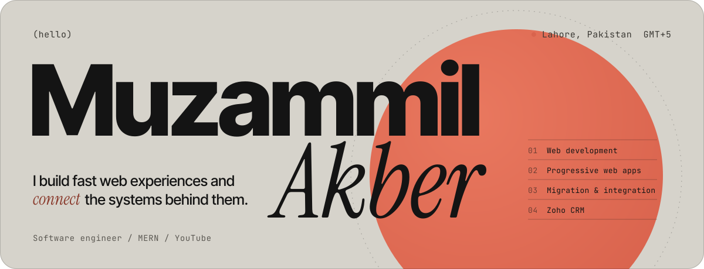

<!-- Palette: stone #D6D3CB · ink #141414 · coral #D9634D · rust #8A3A2C -->

<picture>
  <source media="(prefers-color-scheme: dark)" srcset="header-dark.svg" />
  <source media="(prefers-color-scheme: light)" srcset="header-light.svg" />
  
</picture>

  
  
  
  

 

### About

- Currently learning the full **MERN** stack and looking to collaborate on **React** projects
- I make videos about tech and computer science on **YouTube**
- Ask me about HTML, CSS, Tailwind, JavaScript, React and Git
- I take everything lightly, except coding

### Stack

<picture>
  <source media="(prefers-color-scheme: dark)" srcset="https://skillicons.dev/icons?i=html,css,js,react,redux,tailwind,vite,nodejs,express,mongodb,mysql,firebase,vercel,netlify,git,cpp&theme=dark&perline=8" />
  
</picture>

Also React Router and Canva.

### Activity

  <picture>
    <source media="(prefers-color-scheme: dark)" srcset="https://github-readme-stats.vercel.app/api?username=Muzammil-Akber&show_icons=true&count_private=true&hide_border=true&border_radius=16&bg_color=161514&title_color=E9E6DF&icon_color=D9634D&text_color=C9C5BC" />
    
  </picture>
  <picture>
    <source media="(prefers-color-scheme: dark)" srcset="https://github-readme-stats.vercel.app/api/top-langs/?username=Muzammil-Akber&layout=compact&hide_border=true&border_radius=16&bg_color=161514&title_color=E9E6DF&text_color=C9C5BC" />
    
  </picture>

  <picture>
    <source media="(prefers-color-scheme: dark)" srcset="https://streak-stats.demolab.com/?user=Muzammil-Akber&hide_border=true&border_radius=16&background=161514&ring=D9634D&fire=D9634D&currStreakLabel=E58A73&sideLabels=C9C5BC&dates=9C988F&currStreakNum=E9E6DF&sideNums=E9E6DF&stroke=3A3833" />
    
  </picture>

  <picture>
    <source media="(prefers-color-scheme: dark)" srcset="https://github-readme-activity-graph.vercel.app/graph?username=Muzammil-Akber&bg_color=161514&color=C9C5BC&title_color=E9E6DF&line=D9634D&point=E9E6DF&area=true&area_color=D9634D&hide_border=true&radius=16" />
    
  </picture>

